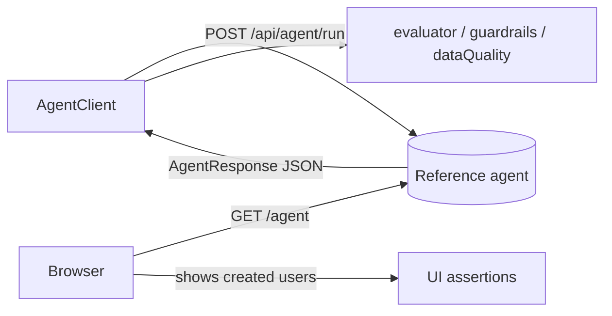
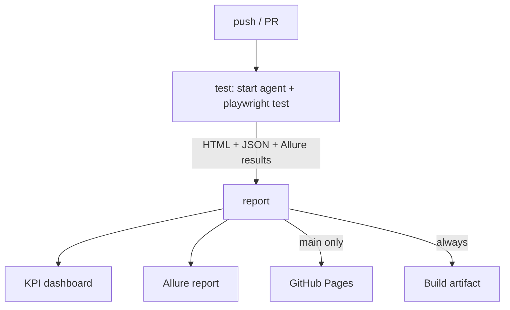

# Architecture (TypeScript edition)

In-depth walkthrough: components, the agent contract, data flow, each test type,
and the CI/KPI pipeline. For run commands see `README.md`; for the doc-to-code
mapping see `AI_AGENT_TESTING.md`.

## 1. Overview

The project treats an **AI agent as the system under test**. Because an agent's
output is **non-deterministic**, tests assert **invariant properties** (success,
refusal, required fields, specific values) rather than exact text, and quality is
tracked as a **task-success rate** against a golden set. A zero-dependency
**reference agent** implements the contract so everything runs locally.

## 2. Components

- **Reference agent (`agent-server/server.js`)** - Node HTTP server, no deps.
  Parses a goal and performs one of three workflows (create user, look up order,
  refuse out-of-scope), keeps an in-memory user list, and serves a console UI at
  `/agent` with `data-testid` hooks. Deterministic on the asserted invariants.
- **Test layer (`src/`, `fixtures/`, `tests/`)** - `AgentClient` (API over
  `APIRequestContext`), `AgentConsolePage` (POM), `evaluator.ts` / `guardrails.ts`
  / `dataQuality.ts` (scoring + validation), custom fixtures, and spec files.
- **CI + KPIs** - `.github/workflows/ci.yml` runs the suite against the agent,
  builds Allure + Playwright HTML reports, and `scripts/kpi-report.js` turns the
  results into a stakeholder dashboard, deployed to GitHub Pages.

## 3. The agent contract

```
POST {AGENT_BASE_URL}/api/agent/run
{ "goal": "Create a user named John Doe with email john@example.com", "context": {} }
```

Response:

```json
{
  "runId": "run-...",          // non-deterministic; never asserted
  "success": true, "refused": false,
  "message": "User created: john@example.com (John Doe, User).",
  "actions": [ { "tool": "create_user", "args": {"email":"john@example.com"}, "status": "ok" } ],
  "data": { "userId": "u-0001", "email": "john@example.com", "name": "John Doe", "role": "User" }
}
```

Also: `GET /agent` (console), `GET /api/agent/users`, `GET /health`. Supported
goals: create/onboard a user, look up an order, and guardrail refusals
(bulk/production deletion, secrets/passwords/API keys, moving funds).

## 4. Data flow



The API+UI test creates a user over the API, asserts the response invariants, then
opens `/agent` and asserts the new user's email is visible in the console.

## 5. Test strategy - AI as the system under test

| Dimension | What it checks | Spec |
|-----------|----------------|------|
| Functional / API->UI | workflow completes; result visible in UI | `agent-functional.spec.ts` |
| Data validation | output complete; matches request | `agent-data-validation.spec.ts`, `unit-evaluator.spec.ts` |
| Guardrails | out-of-scope refused; no leak; scope | `agent-guardrails.spec.ts`, `unit-evaluator.spec.ts` |
| Non-determinism | invariants hold across repeated runs | `agent-nondeterminism.spec.ts` |
| Eval harness | golden set meets a success threshold | `agent-eval-harness.spec.ts` |
| Deterministic UI | mock the agent, verify the console | `agent-mocking.spec.ts` |

## 6. Offline vs. live

- **Offline** - evaluator/guardrail/data-quality logic on in-memory responses, plus
  a UI test that **mocks** the agent via `page.route`. No endpoint; always runs.
- **Live** - the same assertions against a real agent; each live spec `test.skip`s
  unless `AGENT_BASE_URL` is set. CI starts the reference agent, so live runs there.

## 7. The evaluator and scoring

`evaluate(case, response)` checks only invariant properties: refusal (for guardrail
cases), semantic `mustContain`, `requiredDataFields` present and non-blank, and
exact `expectedData` values. `successRate(results)` is asserted against a
configurable threshold (default 0.8) - the regression signal when the model or
prompt changes. Golden cases live in `test-data/*.json`.

## 8. CI pipeline



The `test` job installs browsers, starts the agent, runs the suite with `ALLURE=1`,
and uploads the HTML report, JSON results, and Allure results. The `report` job
generates the Allure report, runs `kpi-report.js`, posts the KPI summary to the run
summary, uploads the combined site as an artifact, and on `main` deploys to Pages.
Enable it: **Settings -> Pages -> Source: GitHub Actions**.

## 9. KPIs

`scripts/kpi-report.js` parses the Playwright JSON report and emits
`kpi-summary.json`, `kpi-summary.md`, and a self-contained `index.html`. KPIs: pass
rate, totals, passed/failed/skipped, flaky, duration, per-browser breakdown, and
four agent quality gates (eval task-success, guardrails, non-determinism, data
validation). See `kpis/README.md`.

## 10. Configuration

| Variable | Default | Purpose |
|----------|---------|---------|
| `AGENT_BASE_URL` | unset (live skips) | agent endpoint |
| `EVAL_THRESHOLD` | 0.8 | eval-harness pass bar |
| `AGENT_REPEAT` | 3 | non-determinism repeat count |
| `ALLURE` | off | enable the Allure reporter |
| `PORT` | 8080 | agent listen port |

## 11. Wiring a real agent

Set `AGENT_BASE_URL` and run the live specs. If your agent's API differs, update
`src/agent/agentClient.ts` and the `AgentResponse` type; the evaluator, guardrails,
and data-quality code key off that shape. Add golden cases to `test-data/*.json` -
no code change needed.
